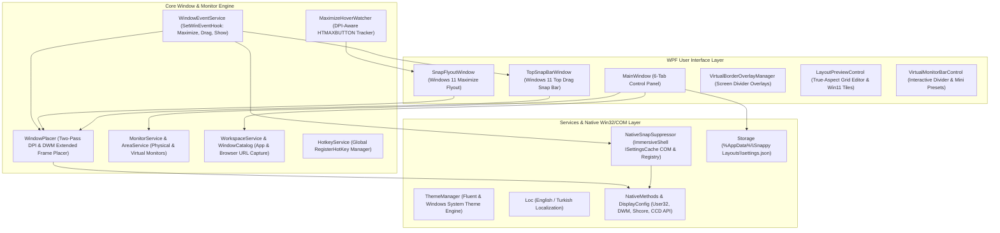

# Snappy Layouts v1.13

[](https://github.com/yusufkilinc44/SnappyLayouts)
[](https://dotnet.microsoft.com/)
[](ARCHITECTURE.md)
[-6366F1)](#6-per-monitor-v2-dynamic-dpi-localization--theming)
[](LICENSE)
[](CHANGELOG.md)

**Author / Design & Programming:** **YUSUF KILINÇ — November 2026**

**Snappy Layouts** is a native-feeling window management, customizable Snap Layouts, side-by-side Virtual Monitors, and Workspace automation utility for **Windows 10 and Windows 11**, built with **.NET 10 (WPF)** and low-level **Win32 / DWM / Shcore / COM** APIs.

---

## Key Features

### 1. Native-Style Maximize Hover Flyout & Top-of-Screen Drag Snap Bar
- **Maximize Button Hover Flyout (`SnapFlyoutWindow`):** Hover over any window's Maximize button (including Snappy Layouts's own main window) or press `Ctrl + Alt + Z` to open a Windows 11-styled layout menu positioned cleanly **below** the Maximize button without covering it.
- **Top-of-Screen Drag Snap Bar (`TopSnapBarWindow`):** Drag any window to the top edge of any physical or virtual monitor to reveal a sleek horizontal Windows 11-style Snap Bar. Hover any zone for a live translucent preview and release the mouse button to snap immediately.
- **Zero-Flash Native Windows 11 Suppression:** Automatically suppresses Windows 11's built-in Snap Flyout and Snap Bar (`XamlExplorerHostIslandWindow`) using a 4-layer approach (`ImmersiveShell` `ISettingsCache` COM refresh, registry flags, `MainWindow` `WndProc` `HTMAXBUTTON` filtering, and synchronous `EVENT_OBJECT_SHOW` hooks) so the native and custom overlays never collide or flicker.
- **Always Matches Windows Theme:** Regardless of whether you choose Light or Dark theme for the management UI, both the Maximize Flyout and Top Drag Snap Bar always follow your active **Windows system theme**.
- **Cross-Monitor Switching & Custom Monitor Names:** Switch between all connected physical monitors and their virtual monitors directly from the Maximize Flyout with live screen previews, and assign custom friendly names to any physical monitor.

### 2. Side-by-Side Virtual Monitors (Equal or Asymmetric Widths)
- Split any physical monitor (especially `21:9` / `32:9` ultrawide or large 4K/5K displays) into unlimited side-by-side **virtual monitors**.
- **Flexible Ratio Adjustment:**
  - Drag divider handles directly on the true-aspect-ratio monitor bar,
  - Use the **`▲` / `▼` spinner buttons**, arrow keys, or mouse wheel on each percentage input,
  - Click one of the built-in quick ratio chips (**`25%`**, **`33%`**, **`50%`**, **`66%`**, **`75%`**, **`100%`**).
- **Saved Virtual Monitor Presets with Visual Thumbnails:** Save your favorite splits (`50% | 50%`, `33% | 33% | 33%`, `25% | 50% | 25%`, `40% | 60%`, etc.) with live aspect-ratio mini diagrams and assign global hotkeys to switch splits instantly.
- **Customizable Virtual Monitor Borders:** Display high-contrast divider lines on screen while dragging windows, while editing ratios, on demand (`Ctrl + Alt + B`), or permanently, with configurable color and thickness.

### 3. Virtual Monitor Full Screen (`100%`) & Permanent Physical Full Screen
- **Virtual Monitor Full Screen & Multi-Virtual-Monitor Spanning:** Clicking a window's Maximize button intercepts the click directly (`WH_MOUSE_LL`) so the window maximizes **strictly inside its current virtual monitor with zero flash to the physical monitor**. On monitors split into 3+ virtual monitors, one-click **Span Chips** (`◫ 1+2`, `◫ 2+3`), `Shift + Click` range spanning, and Top Drag Snap Bar span tiles let you maximize a window across any adjacent virtual monitors.
- **Permanent Physical Full Screen (Indeletable):** Always available (`Shift + Maximize`, `Ctrl + Alt + Shift + ↑`, or from the Flyout/Snap Bar) to maximize a window across the entire physical monitor even when virtual monitors are active.

### 4. Unlimited Grid & Zone Layout Editor (Per-Monitor & Per-Virtual-Monitor)
- Every **physical monitor** and every **virtual monitor** maintains its own completely independent list of snap layouts.
- **True Aspect Ratio Diagrams:** All previews and editor canvases render at the exact aspect ratio of the selected physical or virtual monitor (`16:9`, `21:9`, `32:9`, vertical portrait, etc.).
- **Unlimited Rows & Columns:** Add/remove columns and rows, drag internal grid dividers, enter exact percentages with `▲`/`▼` controls or quick ratio chips, and drag-select adjacent cells to merge or right-click to split them.
- **Orientation Filters:** Control which layouts appear on Standard (`16:9`/`16:10`), Ultrawide (`21:9`/`32:9`), and Portrait displays.

### 5. Workspaces & Browser URL Capture
- Capture your current virtual monitor layout along with open applications, window zone positions, Explorer folder paths, and **active browser tab URLs** (Chrome, Edge, Brave, Vivaldi, Opera, Firefox).
- Restore any saved workspace with one click or a global hotkey — either on your **Current Desktop** or in a freshly created **Windows Virtual Desktop** (`Win + Ctrl + D`).

### 6. Per-Monitor V2 Dynamic DPI, Localization & Theming
- **Two-Pass Dynamic DPI & DWM Frame Compensation:** Seamlessly moves and previews windows across monitors with mixed DPI scales (`100%`, `125%`, `150%`, `175%`, `200%`) with zero pixel drift, compensating for invisible DWM window borders (`DWMWA_EXTENDED_FRAME_BOUNDS`) and `WM_DPICHANGED` rescaling.
- **Localization (8 Languages with Country Flags):** Full UI support for **English** (default), **Turkish**, **Spanish**, **Portuguese**, **Chinese (Simplified)**, **French**, **German**, and **Russian** with crisp vector flag icons in the language selector.
- **Responsive Colorful UI:** Per-section accent colors and a collapsible left sidebar with bold icon badges when resizing the management window into narrow zones.
- **Theming:** **System (Windows)**, **Light**, and **Dark** themes for the management app, with automatic Windows system theme sync for Snap overlays.

---

## Architecture Overview



For a deep technical dive into the Win32, COM, DWM, and Per-Monitor V2 DPI implementation, see [ARCHITECTURE.md](ARCHITECTURE.md).

---

## Project Structure

```text
Snappy Layouts/
├── Snappy Layouts.sln                  # Visual Studio Solution File
├── Baslat-Snappy Layouts.bat           # Quick launcher for Release build
├── README.md                          # Project documentation
├── ARCHITECTURE.md                    # Technical architecture & Win32/COM internals
├── CHANGELOG.md                       # Version history (v0.1 → v0.12)
├── CONTRIBUTING.md                    # Contribution & versioning guidelines
├── SECURITY.md                        # Security & local privacy policy
├── LICENSE                            # MIT License
├── .github/                           # GitHub Actions CI & Issue/PR templates
└── src/
    └── Snappy Layouts/
        ├── Snappy Layouts.csproj       # .NET 10.0 WPF Project File
        ├── app.manifest               # Per-Monitor V2 DPI manifest
        ├── AppInfo.cs                 # Version metadata & changelog
        ├── App.xaml / App.xaml.cs     # Lifecycle, System Tray, Single-Instance Mutex
        ├── Core/
        │   ├── HotkeyService.cs       # Global RegisterHotKey service
        │   ├── MaximizeHoverWatcher.cs# DPI-aware HTMAXBUTTON hover watcher
        │   ├── MonitorService.cs      # Physical & Virtual Monitor (SnapArea) engine
        │   ├── WindowCatalog.cs       # Window enumeration, process paths & browser URLs
        │   ├── WindowEventService.cs  # WinEventHook (Maximize, Drag, Native Flyout suppression)
        │   ├── WindowPlacer.cs        # Two-pass DPI & DWM frame-compensated window placer
        │   └── WorkspaceService.cs    # Workspace capture & Current/New Desktop restore
        ├── Models/
        │   ├── AppData.cs             # Settings, Virtual Presets & Workspace models
        │   └── SnapLayout.cs          # Grid, column/row weights & ZoneCell models
        ├── Native/
        │   ├── DisplayConfig.cs       # QueryDisplayConfig friendly monitor names
        │   └── NativeMethods.cs       # User32, DwmApi, Shcore, Kernel32, Ntdll P/Invoke
        ├── Services/
        │   ├── Loc.cs                 # English & Turkish localization dictionary
        │   ├── NativeSnapSuppressor.cs# Windows 11 native Snap Flyout/Bar suppressor
        │   ├── StartupService.cs      # Run-at-Windows-startup registry service
        │   ├── Storage.cs             # JSON persistence & diagnostic logging
        │   └── ThemeManager.cs        # Light / Dark / Windows System theme manager
        └── UI/
            ├── MainWindow.xaml(.cs)   # Main 6-tab management interface
            ├── Controls/
            │   ├── LayoutPreviewControl.cs       # Grid editor & Windows 11 snap tiles
            │   └── VirtualMonitorBarControl.cs   # Virtual monitor divider & mini previews
            └── Windows/
                ├── HotkeyCaptureDialog.cs        # Interactive hotkey recorder dialog
                ├── SnapFlyoutWindow.cs           # Maximize button hover Snap Flyout
                ├── TopSnapBarWindow.cs           # Top-of-screen drag Snap Bar
                ├── VirtualBorderOverlayManager.cs# On-screen virtual monitor divider lines
                └── WorkspaceDialogs.cs           # Workspace capture & launch dialogs
```

---

## Installation

### Option 1 — Windows Installer (Recommended)
1. Download **`SnappyLayouts-v1.13-Setup.exe`** from the [GitHub Releases](https://github.com/yusufkilinc44/SnappyLayouts/releases) page.
2. Run the installer — installs cleanly into **`C:\Program Files\Snappy Layouts`** with optional Start Menu / Desktop shortcuts and *Start with Windows*.
3. No `.NET` runtime installation is required (fully self-contained).
4. Can be cleanly upgraded in-place (no uninstall required) or uninstalled anytime via **Windows Settings → Installed Apps** (automatically restores native Windows Snap settings).

### Option 2 — Portable ZIP (No Installation)
1. Download **`SnappyLayouts-v1.13-Portable-win-x64.zip`** from [GitHub Releases](https://github.com/yusufkilinc44/SnappyLayouts/releases).
2. Extract to any permanent folder and run **`Snappy Layouts.exe`**.

> [!NOTE]
> **Windows SmartScreen & Antivirus Notice (Unsigned Open-Source Binary)**  
> **Snappy Layouts** is a free, independent open-source project and is not yet signed with a paid Authenticode code-signing certificate. Because it is unsigned and uses standard Windows window-management APIs (`SetWinEventHook`, `WH_MOUSE_LL`, `DWM`), **Windows Defender SmartScreen** (*"Windows protected your PC — Unknown publisher"*) or heuristic antivirus scanners (such as Bitdefender) may show a false-positive warning on first launch:
> - **SmartScreen ("Warn" mode):** Click **More info → Run anyway**.
> - **SmartScreen ("Block" mode — only *"Don't run"* shown):** Right-click the downloaded `SnappyLayouts-v1.13-Setup.exe` → **Properties** → check **Unblock** → **Apply / OK**, then run the installer again.
> - **Third-Party Antivirus:** If your antivirus flags the installed app, add `C:\Program Files\Snappy Layouts` to its exclusions.
> - **Full Transparency:** Every release binary is compiled publicly from this repository via [GitHub Actions](https://github.com/yusufkilinc44/SnappyLayouts/actions) with zero telemetry or network access (see [SECURITY.md](SECURITY.md)), or you can build directly from source below.

### Option 3 — Build from Source & Package Installer Locally
**Prerequisites:** Windows 10 (1809+) or Windows 11, [.NET 10.0 SDK](https://dotnet.microsoft.com/), and optionally [Inno Setup 6](https://jrsoftware.org/isinfo.php) (`winget install JRSoftware.InnoSetup`) to build `Setup.exe`.

```powershell
git clone https://github.com/yusufkilinc44/SnappyLayouts.git
cd SnappyLayouts

# Build Release
dotnet build "Snappy Layouts.sln" -c Release

# Or build self-contained Portable ZIP + Windows Setup.exe into dist/
.\installer\build-release.ps1 -Version "1.13"
```

---

## Default Keyboard Shortcuts

| Action | Default Hotkey |
| :--- | :--- |
| Open Snap Layout Flyout for active window | `Ctrl + Alt + Z` |
| Toggle Virtual Monitor border overlays | `Ctrl + Alt + B` |
| Maximize active window inside its Virtual Monitor | `Ctrl + Alt + ↑` |
| Maximize active window across Full Physical Monitor | `Ctrl + Alt + Shift + ↑` |
| Move active window to next Virtual Monitor | `Ctrl + Alt + →` |
| Move active window to previous Virtual Monitor | `Ctrl + Alt + ←` |
| Restore active window to previous bounds | `Ctrl + Alt + ↓` |
| Toggle Virtual Monitors on / off | `Ctrl + Alt + V` |
| Open Snappy Layouts Control Panel | `Ctrl + Alt + K` |
| Saved Virtual Monitor Presets (auto-assigned) | `Ctrl + Alt + Shift + 1`..`9` |
| Saved Workspaces (auto-assigned) | `Ctrl + Alt + F1`..`F12` |

All shortcuts can be customized or cleared in the **Keyboard Shortcuts** tab, and custom global hotkeys can also be assigned to any saved **Virtual Monitor Preset** or **Workspace**.

---

## License

This project is licensed under the [MIT License](LICENSE).  
© 2026 **YUSUF KILINÇ**
