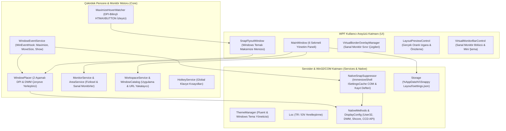

# Snappy Layout v0.12

[](https://github.com/yusufkilinc44/SnappyLayouts)
[](https://dotnet.microsoft.com/)
[](ARCHITECTURE.md)
[](LICENSE)
[](CHANGELOG.md)

**Yazar / Tasarım & Programlama (Author / Design & Programming):** **YUSUF KILINÇ — Kasım 2026 (November 2026)**

> 🇹🇷 **Türkçe açıklama aşağıdadır** • 🇬🇧 **English documentation is included below**

---

## 🇹🇷 Türkçe Dokümantasyon

### Genel Bakış
**Snappy Layout**, Windows 10 ve Windows 11 için geliştirilmiş; **maksimize (büyüt) tuşu üzerinde açılan tamamen özelleştirilebilir pencere yerleşim menüsü (Snap Flyout)**, **tek bir fiziksel monitörü yan yana eşit veya eşit olmayan oranlarda bölen Sanal Monitör sistemi**, **çalışma alanı (uygulama + pencere konumu + tarayıcı URL) kaydedici** ve **Per-Monitor V2 dinamik DPI motoru** sunan güçlü bir masaüstü pencere yöneticisidir.

---

### Temel Özellikler

#### 1. Maksimize Tuşu Üzerinde Özelleştirilmiş Yerleşim Menüsü (Snap Flyout)
- Herhangi bir pencerenin (Snappy Layout'un kendi ana penceresi dahil) sağ üstteki **Büyüt (Maximize)** tuşu üzerine fareyle gelindiğinde veya `Ctrl + Alt + Z` kısayoluyla **Snappy Layout Flyout** menüsü açılır.
- **Windows Orijinal Snap Layouts Bastırma:** Windows 11'in yerleşik `XamlExplorerHostIslandWindow` menüsü; Kayıt Defteri (`EnableSnapAssistFlyout`, `EnableSnapBar`), `ImmersiveShell` `ISettingsCache` COM servisi, `WndProc` `HTMAXBUTTON` filtrelemesi ve `EVENT_OBJECT_SHOW` anlık kancasıyla tamamen devre dışı bırakılır. İki menü asla üst üste binmez veya yanıp sönmez.
- **Maksimize Tuşunu Kapatmayan Konumlandırma:** Flyout penceresi, tıpkı Windows'un orijinal menüsü gibi başlık çubuğunun / maksimize tuşunun hemen altında açılır; maksimize tuşunun üzerini kapatmaz.
- **Her Zaman Windows Teması:** Uygulama arayüzü hangi temada (Açık / Koyu) olursa olsun, pencerelerin maksimize tuşu üzerinde açılan Flyout menüsü her zaman doğrudan **Windows sistem temasını** kullanır.
- **Canlı Hedef Önizleme:** Flyout içindeki herhangi bir bölge kutusunun üzerine gelindiğinde, pencerenin ekranda yerleşeceği tam alan yarı saydam bir çerçeveyle canlı olarak gösterilir.

#### 2. Yan Yana Sanal Monitörler (Eşit veya Eşit Olmayan Oranlar)
- Tek bir fiziksel monitörü (özellikle `21:9`, `32:9` Ultra-Wide veya büyük 4K/5K ekranları) yazılımsal olarak yan yana istediğiniz sayıda **sanal monitöre** bölebilirsiniz.
- **Esnek Oran Kontrolü:**
  - Görsel monitör çubuğu üzerindeki ayırıcı çizgileri fareyle sola/sağa sürükleyerek,
  - Oran kutularındaki **alt-üst sayı arttırma/azaltma (`▲` / `▼`)** butonlarını veya fare tekerleğini kullanarak,
  - **`25%`, `33%`, `50%`, `66%`, `75%`, `100%`** hızlı seçim çiplerine tek tıkla basarak genişlikleri ayarlayabilirsiniz.
- **Kayıtlı Sanal Monitör Şablonları (Presets):** Sık kullandığınız sanal monitör bölme oranlarını (`50% | 50%`, `33% | 33% | 33%`, `25% | 50% | 25%`, `40% | 60%` vb.) şablon olarak kaydedebilir, her şablonun yanındaki **gerçek en/boy oranlı görsel küçük önizleme şemasından** nasıl göründüğünü anında görebilir ve kısayol tuşu atayabilirsiniz.
- **Sanal Monitör Sınır Çizgileri:** Pencere sürüklerken, ayar yaparken, `Ctrl + Alt + B` kısayoluyla veya sürekli olarak ekranda özelleştirilebilir renk ve kalınlıkta gösterilir.

#### 3. Sanal Monitör Tam Ekran (`100%`) ve Silinemez Gerçek Fiziksel Tam Ekran
- **Sanal Monitör Tam Ekran:** Sanal monitör aktifken bir pencerede Tam Ekran (Maximize) tuşuna basıldığında pencere tüm fiziksel monitörü değil, **yalnızca bulunduğu sanal monitörü** kaplar. Bu seçenek Flyout menüsünde ve yerleşim listesinde **her zaman alttaki yerleşim düzenlerinin en başında (`100%` kartı olarak)** yer alır.
- **Gerçek Fiziksel Tam Ekran (Silinemez):** Sanal monitörler aktif olsa bile pencereyi gerçek fiziksel monitörün tamamına kaplatan sabit yerleşimdir (`Shift + Maximize` veya `Ctrl + Alt + Shift + ↑` ile de tetiklenebilir) ve silinemez.

#### 4. Bağımsız Pencere Yerleşim Düzenleri & Sınırsız Izgara Düzenleyici
- Her **fiziksel monitör** ve her **sanal monitör** birbirinden tamamen bağımsız pencere yerleşim düzeni listesine sahiptir (2 aşamalı seçim).
- **Gerçek En/Boy Oranı (Aspect Ratio):** Tüm önizleme şemaları ve düzenleyici tuvali, seçili fiziksel veya sanal monitörün gerçek en/boy oranında (`16:9`, `21:9`, `32:9`, dikey portre vb.) çizilir.
- **Sınırsız Sütun ve Satır:** İstediğiniz kadar sütun ve satır ekleyebilir, iç çizgileri sürükleyerek veya `▲`/`▼` butonları ve `%25, %33, %50, %66, %75, %100` hazır oran çipleriyle boyutlandırabilir, birden fazla hücreyi sürükleyip seçerek tek bölge halinde birleştirebilirsiniz (`Merge` / `Split`).

#### 5. Çalışma Alanları (Workspaces) ve Tarayıcı URL Kaydı
- O anki sanal monitör oranlarını, açık uygulamaları, pencerelerin ekran/bölge konumlarını, açık klasör yollarını ve **tarayıcıların (Chrome, Edge, Brave, Vivaldi, Opera, Firefox) aktif sekme URL adreslerini** kaydeder.
- Kaydedilen çalışma alanını tek tıkla veya klavye kısayoluyla **Mevcut Masaüstünde** ya da otomatik oluşturulan **Yeni Sanal Masaüstünde (`Win + Ctrl + D`)** başlatır.

#### 6. Per-Monitor V2 Dinamik DPI, TR/EN Dil ve Açık/Koyu Tema
- **İki Aşamalı Dinamik DPI Yerleştirme:** `%100`, `%125`, `%150`, `%175`, `%200` gibi farklı ölçeklendirmeye sahip monitörler arasında pencere taşırken DWM görünmez çerçeve paylarını (`DWMWA_EXTENDED_FRAME_BOUNDS`) iki geçişte telafi ederek sıfır piksel kaymasıyla yerleştirir.
- **Dil Desteği:** Türkçe ve İngilizce (varsayılan: Windows görüntüleme dili).
- **Tema Desteği:** Açık (Light), Koyu (Dark) ve Windows Varsayılanı.

---

### Mimari Şema



---

### Proje Klasör Yapısı

```text
Snappy Layouts/
├── Snappy Layout.sln                  # Visual Studio Çözüm Dosyası
├── Baslat-Snappy Layout.bat           # Derlenmiş Release sürümünü hızlı başlatma betiği
├── README.md                          # Proje dokümantasyonu (TR / EN)
├── ARCHITECTURE.md                    # Teknik mimari ve Win32/COM detayları
├── CHANGELOG.md                       # Sürüm geçmişi (v0.1 → v0.9)
├── CONTRIBUTING.md                    # Katkıda bulunma ve sürüm politikası rehberi
├── SECURITY.md                        # Güvenlik ve gizlilik politikası
├── LICENSE                            # MIT Lisansı
├── .github/                           # GitHub Actions CI ve Issue/PR şablonları
└── src/
    └── Snappy Layout/
        ├── Snappy Layout.csproj       # .NET 10.0 WPF Proje Dosyası
        ├── app.manifest               # Per-Monitor V2 DPI bildirimi
        ├── AppInfo.cs                 # Sürüm bilgisi ve değişiklik geçmişi
        ├── App.xaml / App.xaml.cs     # Uygulama yaşam döngüsü, Tepsi İkonu, Tek Örnek (Mutex)
        ├── Core/
        │   ├── HotkeyService.cs       # Global RegisterHotKey yönetimi
        │   ├── MaximizeHoverWatcher.cs# Maksimize tuşu hover tespiti
        │   ├── MonitorService.cs      # Fiziksel ve sanal monitör (SnapArea) hesaplamaları
        │   ├── WindowCatalog.cs       # Açık pencereler, süreç yolları ve tarayıcı URL tespiti
        │   ├── WindowEventService.cs  # SetWinEventHook (Maximize, Sürükleme, Native Flyout engelleme)
        │   ├── WindowPlacer.cs        # DWM çerçeve telafili ve çoklu-DPI pencere yerleştirici
        │   └── WorkspaceService.cs    # Çalışma alanı yakalama ve mevcut/yeni masaüstünde açma
        ├── Models/
        │   ├── AppData.cs             # Ayarlar, sanal monitör şablonları, çalışma alanları modelleri
        │   └── SnapLayout.cs          # Izgara, sütun/satır ağırlıkları ve bölge (ZoneCell) modelleri
        ├── Native/
        │   ├── DisplayConfig.cs       # QueryDisplayConfig ile gerçek monitör adı okuma
        │   └── NativeMethods.cs       # User32, DwmApi, Shcore, Kernel32, Ntdll P/Invoke tanımları
        ├── Services/
        │   ├── Loc.cs                 # Türkçe / İngilizce dil sözlüğü
        │   ├── NativeSnapSuppressor.cs# Windows 11 yerleşik Snap Flyout bastırıcı (COM + Registry)
        │   ├── StartupService.cs      # Windows başlangıcında otomatik çalıştırma
        │   ├── Storage.cs             # JSON tabanlı kalıcı ayar yönetimi ve günlükleme
        │   └── ThemeManager.cs        # Açık / Koyu / Windows teması fırça yöneticisi
        └── UI/
            ├── MainWindow.xaml(.cs)   # Ana yönetim penceresi
            ├── Controls/
            │   ├── LayoutPreviewControl.cs      # Etkileşimli ızgara düzenleyici ve önizleme kontrolü
            │   └── VirtualMonitorBarControl.cs  # Sanal monitör bölücü ve mini şablon önizleme
            └── Windows/
                ├── HotkeyCaptureDialog.cs       # Tuş kombinasyonu yakalama penceresi
                ├── SnapFlyoutWindow.cs          # Maksimize tuşu altında açılan yerleşim menüsü
                ├── VirtualBorderOverlayManager.cs# Ekran üstü sanal monitör sınır çizgileri
                └── WorkspaceDialogs.cs          # Çalışma alanı kaydetme ve uygulama diyalogları
```

---

### Kurulum ve Çalıştırma

#### Gereksinimler
- **İşletim Sistemi:** Windows 10 (1809+) veya Windows 11
- **Çalışma Zamanı / SDK:** [.NET 10.0 SDK / Desktop Runtime](https://dotnet.microsoft.com/)

#### Kaynak Koddan Derleme
```powershell
git clone https://github.com/yusufkilinc44/SnappyLayouts.git
cd "SnappyLayouts"
dotnet build "src/Snappy Layout/Snappy Layout.csproj" -c Release
```

#### Çalıştırma
- Ana dizindeki `Baslat-Snappy Layout.bat` dosyasına çift tıklayarak veya:
```powershell
dotnet run --project "src/Snappy Layout/Snappy Layout.csproj" -c Release
```
komutuyla başlatabilirsiniz.

---

### Varsayılan Klavye Kısayolları

| İşlem | Varsayılan Kısayol |
| :--- | :--- |
| Aktif pencere için yerleşim menüsünü (Flyout) aç | `Ctrl + Alt + Z` |
| Sanal monitör sınır çizgilerini göster / gizle | `Ctrl + Alt + B` |
| Aktif pencereyi bulunduğu sanal monitörde tam ekran yap | `Ctrl + Alt + ↑` |
| Aktif pencereyi gerçek fiziksel monitörde tam ekran yap | `Ctrl + Alt + Shift + ↑` |
| Aktif pencereyi sonraki sanal monitöre taşı | `Ctrl + Alt + →` |
| Aktif pencereyi önceki sanal monitöre taşı | `Ctrl + Alt + ←` |
| Aktif pencereyi önceki boyutuna döndür | `Ctrl + Alt + ↓` |
| Sanal monitörleri etkinleştir / devre dışı bırak | `Ctrl + Alt + V` |
| Snappy Layout yönetim penceresini aç | `Ctrl + Alt + S` |

---

## 🇬🇧 English Documentation

### Overview
**Snappy Layout** is a modern window layout, virtual monitor splitter, and workspace automation utility for Windows 10 and Windows 11 built with **.NET 10 WPF** and native Win32/DWM/Shcore APIs.

### Key Highlights
- **Custom Maximize Button Snap Flyout:** Appears directly below any window's Maximize button (without covering the button itself) and always matches the active **Windows system theme**.
- **Zero-Flash Native Snap Suppression:** Suppresses Windows 11's built-in `XamlExplorerHostIslandWindow` via `ImmersiveShell` `ISettingsCache` COM refresh, registry flags, `WndProc` `HTMAXBUTTON` filtering on `MainWindow`, and synchronous `EVENT_OBJECT_SHOW` hooks.
- **Side-by-Side Virtual Monitors:** Split any physical monitor into unlimited side-by-side virtual monitors with equal or non-equal widths using interactive drag dividers, `▲`/`▼` spinner buttons, or one-click `25%`, `33%`, `50%`, `66%`, `75%`, `100%` preset chips.
- **Virtual Monitor Full Screen (`100%`) & Permanent Physical Full Screen:** Maximizing a window fills only its active virtual monitor, while the Virtual Monitor Full Screen card is always placed first among the layout cards. Permanent Physical Full Screen is always available (`Shift + Maximize` or `Ctrl + Alt + Shift + ↑`).
- **Visual Ratio Thumbnails:** Every saved virtual monitor preset and window snap layout is rendered with a true-aspect-ratio visual diagram.
- **Workspaces & Browser URL Capture:** Save virtual monitor ratios, open applications, window positions, and browser tab URLs, and restore them in the Current Desktop or a New Virtual Desktop (`Win + Ctrl + D`).

---

## Lisans / License

Bu proje [MIT Lisansı](LICENSE) altında lisanslanmıştır.  
© 2026 **YUSUF KILINÇ** — Tüm hakları saklıdır.
